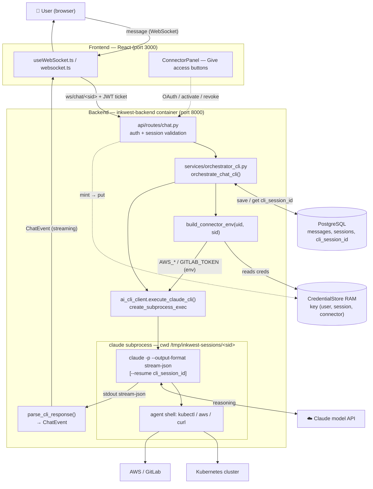
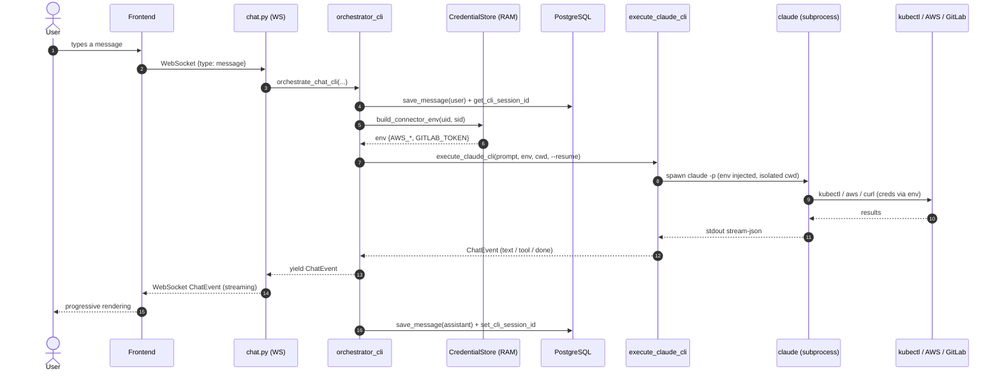
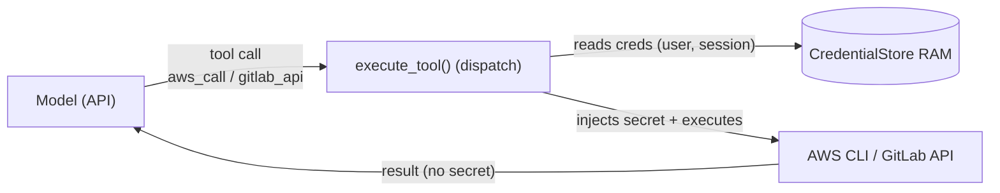
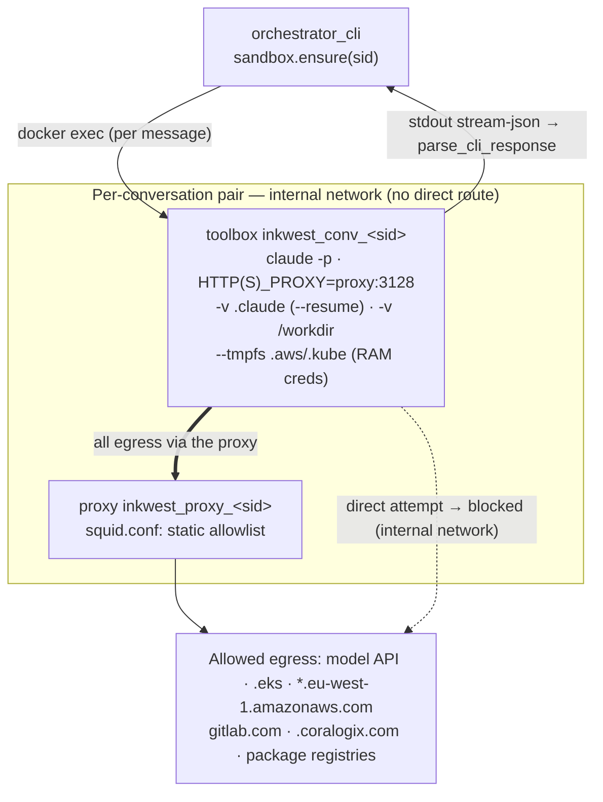

# Inkwest — Message flow (user → Claude)

Diagrams of a message's path in **`claude-cli`** mode (current config), plus
the variants (API providers, sandbox). The secret never crosses the frontend or
the prompt: it is injected into the `claude` process environment on the backend side.

## 1. Component view (flowchart)

## 2. Message lifecycle (sequence)

## 3. Variant — API providers (Gemini / GPT / Anthropic…)

No shell: the model requests a *tool*, the backend injects the secret and executes,
then returns the result to the model (tool-use loop). Scoped tools, native isolation.

## 4. Variant — sandbox (implemented, `SANDBOX_ENABLED=true`)

Strong isolation: **one container pair per conversation** (reused from one
message to the next, for `--resume`) instead of running `claude` in the backend
container. See `app/services/sandbox.py`.

- **toolbox** (`inkwest_conv_<sid>`) — image `SANDBOX_TOOLBOX_IMAGE` (`claude` +
  `kubectl` + `aws`). Placed on an `--internal` network: **no direct egress**. The
  backend runs `docker exec … claude -p` in it per message (stdout unchanged →
  `parse_cli_response`).
- **squid proxy** (`inkwest_proxy_<sid>`) — dual-network (internal + external). Applies
  a **static allowlist** (`sandbox/squid.conf`, mounted read-only) that
  already covers every connector + model backend; a grant does **not** open a
  domain (no reload). `access.log` is mounted on the backend side → durable egress audit
  + UI tab.
- The backend drives a dedicated **dind** daemon; lazy provisioning
  on the 1st message, idle reaper (TTL), orphan sweep at startup.

---

### Notes
- **Secret never exposed**: browser/prompt/logs never see the creds;
  injected into the `claude` process `env` (or HTTP header for API tools).
- **History**: in `claude-cli`, held by Claude Code via `--resume <cli_session_id>`
  (Inkwest stores the ID in DB).
- **Conversation isolation**: distinct cwd `/tmp/inkwest-sessions/<sid>` per session.
- **Filesystem/network isolation**: by default `claude` runs in the backend
  container (filesystem access, unrestricted egress); with `SANDBOX_ENABLED=true` each
  conversation is isolated in its toolbox+squid pair (§4).
