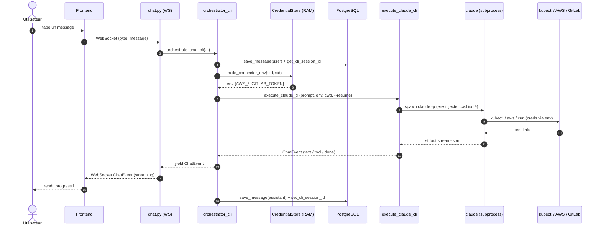
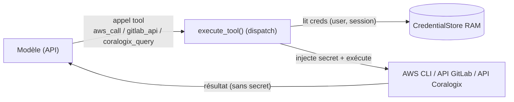
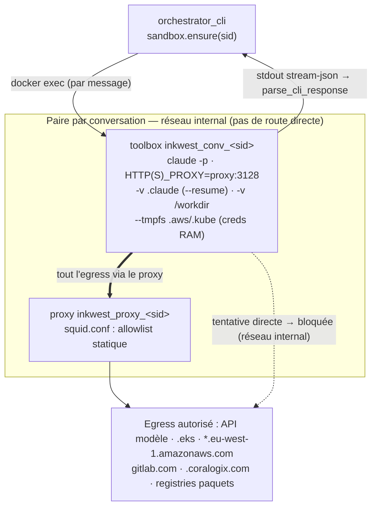

# Inkwest — Flux d'un message (utilisateur → Claude)

Diagrammes du parcours d'un message en mode **`claude-cli`** (config actuelle), plus
les variantes (providers API, sandbox). Le secret ne traverse jamais le frontend ni
le prompt : il est injecté dans l'environnement du process `claude` côté backend.

## 1. Vue composants (flowchart)

```mermaid
flowchart TD
    U["👤 Utilisateur (navigateur)"]

    subgraph FE["Frontend — React (port 3000)"]
      WSHOOK["useWebSocket.ts / websocket.ts"]
      PANEL["ConnectorPanel — boutons Donner accès"]
    end

    subgraph BE["Backend — conteneur inkwest-backend (port 8000)"]
      CHAT["api/routes/chat.py<br/>auth + validation session"]
      ORCH["services/orchestrator_cli.py<br/>orchestrate_chat_cli()"]
      ENVB["build_connector_env(uid, sid)"]
      CLI["ai_cli_client.execute_claude_cli()<br/>create_subprocess_exec"]
      PARSE["parse_cli_response()<br/>→ ChatEvent"]
      subgraph SUB["Sous-process claude — cwd /tmp/inkwest-sessions/&lt;sid&gt;"]
        CLAUDE["claude -p --output-format stream-json<br/>[--resume cli_session_id]"]
        SHELL["shell de l'agent : kubectl / aws / curl"]
      end
    end

    STORE[("CredentialStore RAM<br/>clé (user, session, connector)")]
    DB[("PostgreSQL<br/>messages, sessions, cli_session_id")]
    MODEL["☁️ API du modèle Claude"]
    K8S["Cluster Kubernetes"]
    EXT["AWS / GitLab / Coralogix"]

    U -->|"message (WebSocket)"| WSHOOK
    WSHOOK -->|"ws/chat/&lt;sid&gt; + ticket JWT"| CHAT
    CHAT --> ORCH
    ORCH <-->|"save / get cli_session_id"| DB
    ORCH --> ENVB
    ENVB -->|"lit les creds"| STORE
    ENVB -->|"AWS_* / GITLAB_TOKEN (env)"| CLI
    ORCH --> CLI
    CLI --> CLAUDE
    CLAUDE --> SHELL
    SHELL --> K8S
    SHELL --> EXT
    CLAUDE <-->|"raisonnement"| MODEL
    CLAUDE -->|"stdout stream-json"| PARSE
    PARSE -->|"ChatEvent (streaming)"| WSHOOK
    WSHOOK --> U

    PANEL -.->|"OAuth / activate / revoke"| CHAT
    CHAT -.->|"mint → put"| STORE
```



## 2. Cycle de vie d'un message (séquence)



## 3. Variante — providers API (Gemini / GPT / Anthropic…)

Pas de shell : le modèle demande un *tool*, le backend injecte le secret et exécute,
puis renvoie le résultat au modèle (boucle tool-use). Outils scopés, isolation native.



## 4. Variante — sandbox (implémentée, `SANDBOX_ENABLED=true`)

Isolation forte : **une paire de conteneurs par conversation** (réutilisée d'un
message à l'autre, pour `--resume`) au lieu de lancer `claude` dans le conteneur
backend. Voir `app/services/sandbox.py`.

- **toolbox** (`inkwest_conv_<sid>`) — image `SANDBOX_TOOLBOX_IMAGE` (`claude` +
  `kubectl` + `aws`). Posé sur un réseau `--internal` : **aucun egress direct**. Le
  backend y exécute `docker exec … claude -p` par message (stdout inchangé →
  `parse_cli_response`).
- **proxy squid** (`inkwest_proxy_<sid>`) — bi-réseau (internal + externe). Applique
  une **allowlist statique** (`sandbox/squid.conf`, montée en lecture seule) qui
  couvre déjà tous les connecteurs + backends de modèle ; un grant n'ouvre **pas** de
  domaine (pas de reload). `access.log` est monté côté backend → audit egress durable
  + onglet UI.
- Le backend pilote un daemon **dind** dédié ; provisioning paresseux
  au 1er message, reaper d'inactivité (TTL), balayage des orphelins au démarrage.



---

### Notes
- **Secret jamais exposé** : navigateur/prompt/logs ne voient jamais les creds ;
  injection dans l'`env` du process `claude` (ou en-tête HTTP côté tools API).
- **Historique** : en `claude-cli`, tenu par Claude Code via `--resume <cli_session_id>`
  (Inkwest mémorise l'ID en DB).
- **Isolation conversations** : cwd `/tmp/inkwest-sessions/<sid>` distinct par session.
- **Isolation filesystem/réseau** : par défaut `claude` tourne dans le conteneur
  backend (accès filesystem, egress libre) ; avec `SANDBOX_ENABLED=true` chaque
  conversation est isolée dans sa paire toolbox+squid (§4).
```
