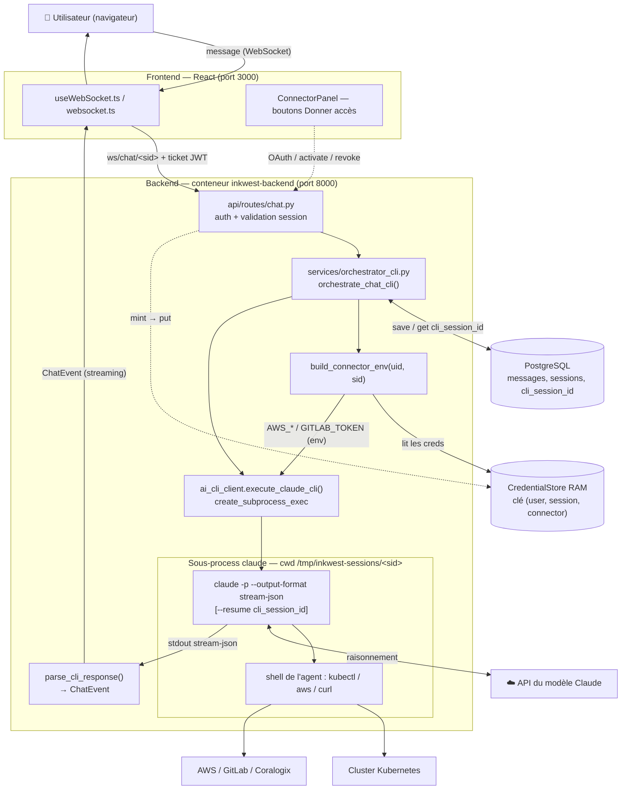
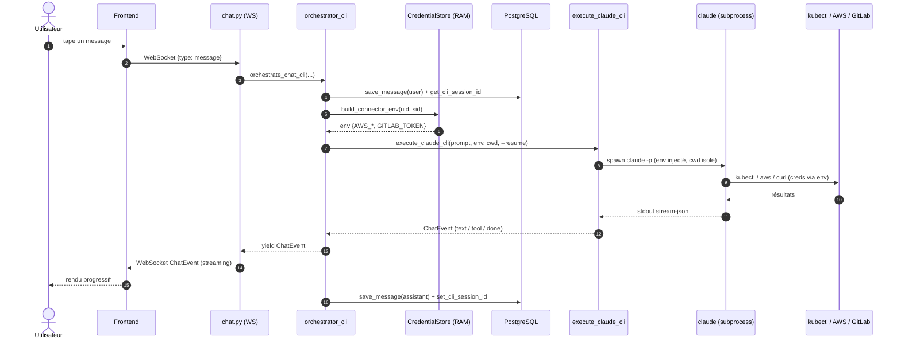
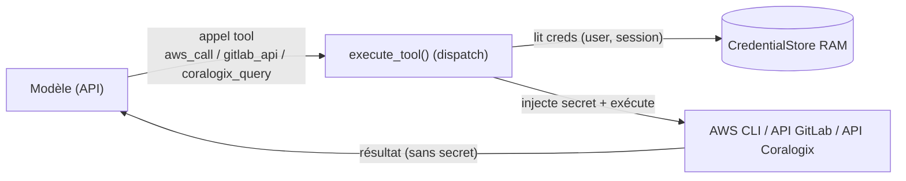
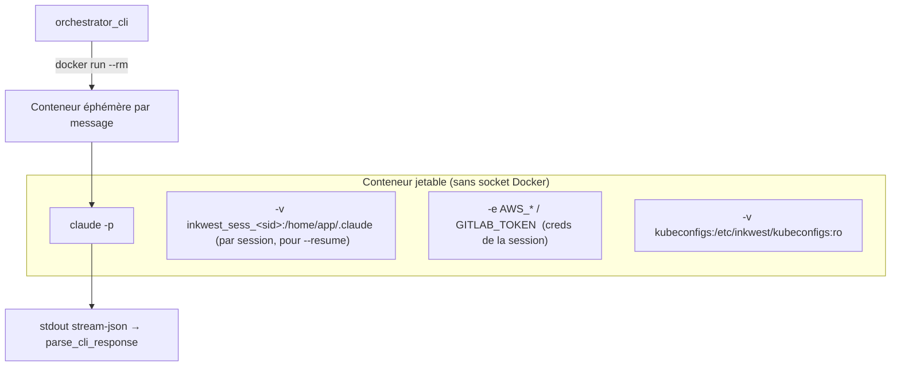

# Inkwest — Flux d'un message (utilisateur → Claude)

Diagrammes du parcours d'un message en mode **`claude-cli`** (config actuelle), plus
les variantes (providers API, sandbox). Le secret ne traverse jamais le frontend ni
le prompt : il est injecté dans l'environnement du process `claude` côté backend.

## 1. Vue composants (flowchart)



## 2. Cycle de vie d'un message (séquence)



## 3. Variante — providers API (Gemini / GPT / Anthropic…)

Pas de shell : le modèle demande un *tool*, le backend injecte le secret et exécute,
puis renvoie le résultat au modèle (boucle tool-use). Outils scopés, isolation native.



## 4. Variante — sandbox (proposée, non implémentée)

Un conteneur éphémère par message → isolation forte (l'agent ne voit ni `/app` ni
`~/.claude` du backend).



---

### Notes
- **Secret jamais exposé** : navigateur/prompt/logs ne voient jamais les creds ;
  injection dans l'`env` du process `claude` (ou en-tête HTTP côté tools API).
- **Historique** : en `claude-cli`, tenu par Claude Code via `--resume <cli_session_id>`
  (Inkwest mémorise l'ID en DB).
- **Isolation conversations** : cwd `/tmp/inkwest-sessions/<sid>` distinct par session.
- **Limite actuelle** : `claude` tourne dans le conteneur backend (accès filesystem) →
  voir la variante sandbox §4 pour l'isolation forte.
```
