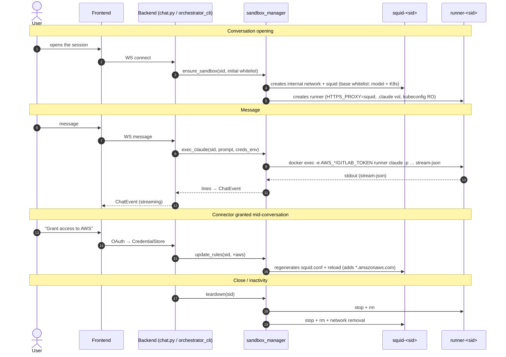
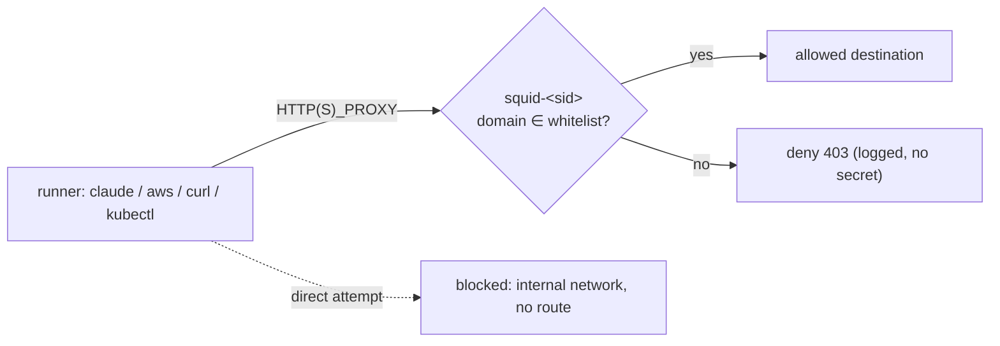
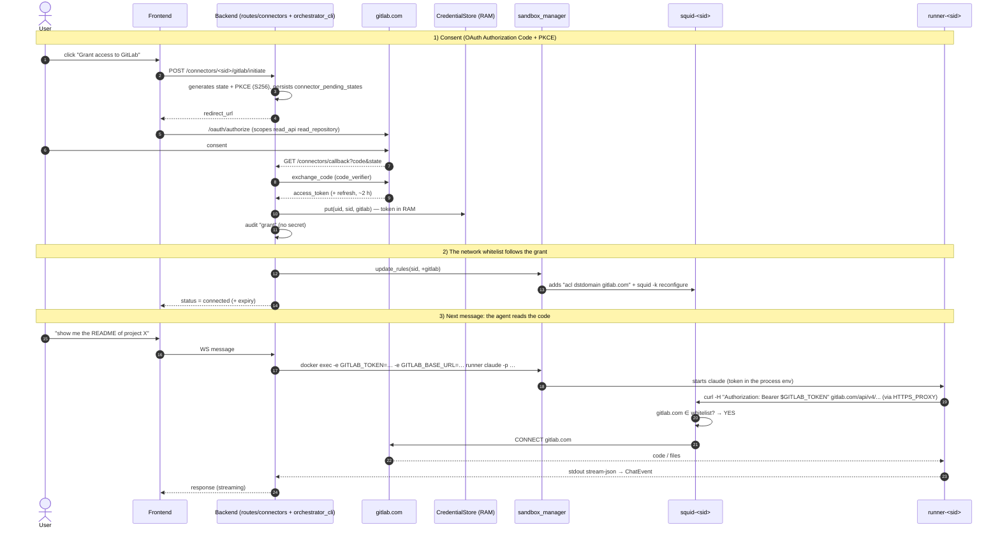
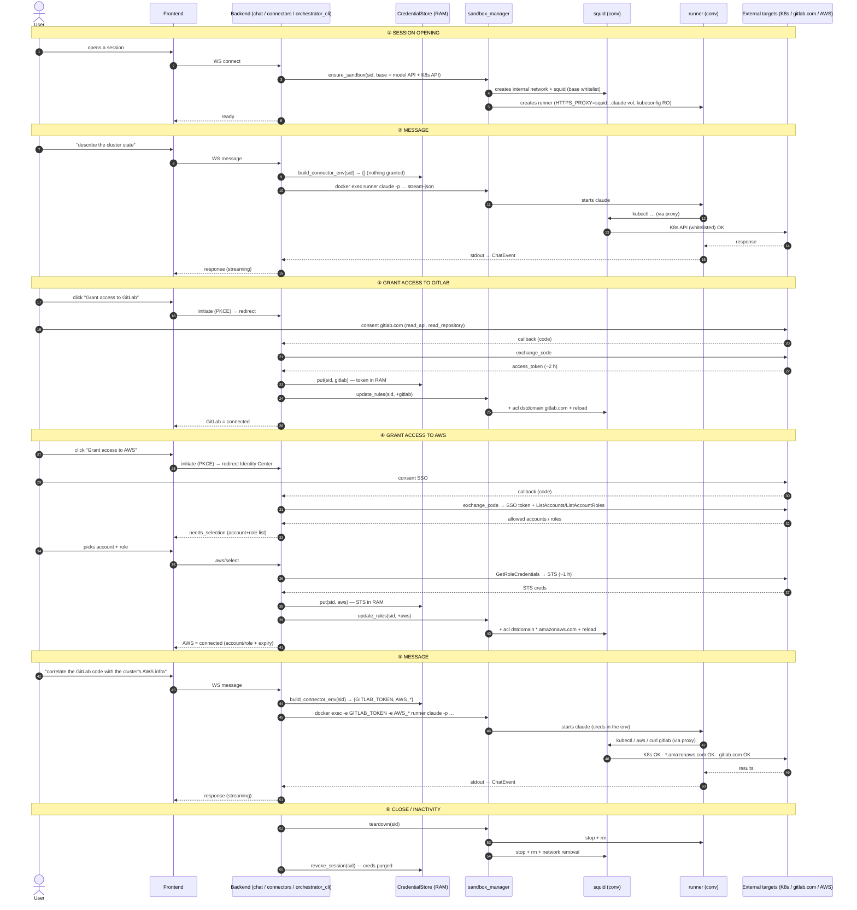

# Architecture proposal — Per-conversation `claude` sandbox (with dedicated Squid)

> **Status: IMPLEMENTED** (`SANDBOX_ENABLED=true`) — see `app/services/sandbox.py`,
> `sandbox/squid.conf`, `docker-compose.yml`. This document is kept as a design
> record; the implementation diverged on several points (below). For the
> current flow, see `ARCHITECTURE_FLOW.md` §4 and `docs/diagrams/end_to_end.mmd`.
>
> **Proposal → implementation divergences:**
> - **STATIC Squid allowlist, not dynamic.** No `update_rules()` and no
>   `squid -k reconfigure`: a single `squid.conf` (mounted read-only) already allows
>   *all* connectors + model backends. A grant/revoke only acts on the
>   **creds layer** (RAM) — the "per-conversation network defence in depth"
>   of §5 was not kept (simplicity; least privilege is still carried by the
>   creds). §4/§5/§10-phase-4, which describe the dynamic reload, are **obsolete**.
> - **Naming**: service `sandbox.py` (not `sandbox_manager.py`); flag
>   `SANDBOX_ENABLED` (not `CLAUDE_CLI_SANDBOX`); containers `inkwest_conv_<sid>` /
>   `inkwest_proxy_<sid>`, networks `inkwest_intnet_<sid>` / `inkwest_extnet_<sid>`.
>   Image = `SANDBOX_TOOLBOX_IMAGE` ("toolbox", not "runner").
> - **DooD via a dedicated dind daemon** (TLS), not the host Docker socket.
> - **Unplanned additions**: LLM-parseable Squid error pages (`sandbox/errors`),
>   `access.log` tail for a UI tab, `.aws`/`.kube` creds projection in RAM,
>   per-container CPU/memory/pids limits.
>
> ---
>
> **Initial statement.** Goal: run `claude` in a
> Docker image **isolated at filesystem + network level**, where **all egress goes
> through a Squid owned by the conversation**, with a **per-conversation whitelist**
> (each conversation can have different rules, aligned with the granted
> connectors).

## 1. Motivation

Today `claude` runs in the shared backend container → it sees `/app`,
`~/.claude`, and has unrestricted egress. Problems: no filesystem/network isolation,
no control over destinations.

Target: **one disposable sandbox per conversation**, where:
- the agent sees neither the Inkwest source nor the state of other conversations;
- **all outbound network access is forced through a Squid**, which only allows
  explicitly whitelisted domains;
- the **whitelist is specific to each conversation**: it reflects the connectors
  actually granted (e.g. conv. A = model + K8s + AWS + GitLab; conv. B = model
  + K8s + Coralogix only).

## 2. Key principle for backend ↔ runner communication

**The pipeline is not rewritten.** The backend keeps **spawning a process and
reading its `stdout`** (stream-json); only *which* process changes:

| Today | Proposal |
|---|---|
| `create_subprocess_exec("claude", "-p", …)` | `create_subprocess_exec("docker", "exec", "-e", …, "runner-<sid>", "claude", "-p", …)` |

→ `parse_cli_response` is **unchanged**: the "communication with the other container"
= the `stdout` of `docker exec`. No custom network protocol to write.

We choose the **long-lived runner per conversation** variant (`docker exec` per
message) over an ephemeral `docker run`: the `~/.claude` state (auth + `--resume`)
naturally persists in the runner, and there is no per-message startup
cost.

## 3. Target architecture


Only **squid-<sid>** is dual-homed (internal + external). The runner has **no
direct route**: its only way out is the proxy.

## 4. Lifecycle



## 5. Egress control + per-conversation whitelist



**Whitelist derived from granted connectors** (the "per-conversation rules" lever):

| Always | If AWS granted | If GitLab granted | If Coralogix granted |
|---|---|---|---|
| model API endpoint, K8s API server | `*.amazonaws.com` (sts, sso, sso-oidc, eks, ec2, logs…) | `gitlab.com` | Coralogix endpoint |

On each connector `grant`/`revoke`, `sandbox_manager.update_rules()` regenerates the
conversation's `squid.conf` and reloads Squid (`squid -k reconfigure`). The
network whitelist thus **follows** the least privilege already enforced at the
creds level.

> HTTPS: Squid filters on the domain via `CONNECT`/SNI (no TLS interception, no
> decryption) — an `acl dstdomain` is enough.

### 5.1 Detailed example — "Grant access to GitLab"

Granting a connector acts on **two complementary layers**: the **token**
(creds layer) **and** the **network whitelist** (Squid layer). Both are added on
grant and removed on revoke → defence in depth.



**Step by step:**
1. **Consent**: button → `initiate` (generates `state` + PKCE, stores the
   pending-state) → redirect to `gitlab.com/oauth/authorize` (scopes
   **`read_api read_repository`** only) → the user consents.
2. **Callback**: `exchange_code` exchanges the `code` for an **access token** (~2 h)
   + refresh; the token is stored **in RAM** (`CredentialStore`, key `(user, session,
   gitlab)`); "grant" **audit** row without secret.
3. **Whitelist**: the backend calls `sandbox_manager.update_rules(sid, +gitlab)`, which
   **adds `gitlab.com`** to the `squid.conf` of **this** conversation and reloads Squid.
   → egress to GitLab becomes possible **for this conversation only**.
4. **UI**: the GitLab badge switches to **connected** (with expiry shown).
5. **Usage**: on the next message, `orchestrator_cli` injects `GITLAB_TOKEN` +
   `GITLAB_BASE_URL` into the `env` of the `docker exec`. The agent runs a `curl` to the
   GitLab API **via the Squid proxy**; Squid sees `gitlab.com` in the whitelist →
   lets it through → the agent reads the code.

**The two locks (defence in depth):**

| Layer | Added on grant | Effect if missing |
|---|---|---|
| **Token** (`GITLAB_TOKEN` injected per session) | yes | no token → `401` from GitLab |
| **Squid whitelist** (`gitlab.com`) | yes | no whitelist → the request **never** reaches GitLab (egress blocked by the internal network) |

→ Even if a token leaked, the runner could not reach `gitlab.com` without the
whitelist entry; and vice versa.

**Revocation / expiry:** on `revoke` (or on expiry), the backend
(1) removes the token from the store and (2) calls `update_rules(sid, -gitlab)`, which **removes
`gitlab.com`** from the whitelist + reload. Both locks close together.

> Note: this flow is the "sandbox" extension of the GitLab flow **already working**
> today (steps 1-2-5). What is **new** is step 3 (dynamic Squid whitelist)
> and passing the token via `docker exec -e` instead of the backend process env.

### 5.2 Full end-to-end scenario

Session opening → message → GitLab access → AWS access → message → close.



**Quick read:**
- ① the sandbox starts with a **minimal** whitelist (model + K8s);
- ③/④ each grant **extends** the conversation's Squid whitelist (gitlab.com, then
  `*.amazonaws.com`) **in addition** to storing the credential in RAM;
- ⑤ on the next message, the creds are injected via `docker exec -e` and the agent
  reaches K8s + AWS + GitLab — each egress going through the Squid filter;
- ⑥ on close, runner + squid + network are destroyed and the creds purged.

## 6. Components to create / modify

| Item | Role |
|---|---|
| `app/services/sandbox_manager.py` *(new)* | `ensure_sandbox(sid, targets)`, `exec_claude(sid, cmd, env)`, `update_rules(sid, targets)`, `teardown(sid)` — drives network + squid + runner via the Docker socket |
| `app/services/ai_cli_client.py` *(modified)* | behind `CLAUDE_CLI_SANDBOX=true`, builds `["docker","exec",…,"runner-<sid>","claude",…]` instead of `["claude",…]`; `stdout` unchanged |
| `app/services/orchestrator_cli.py` *(modified)* | calls `ensure_sandbox` on the 1st interaction, `update_rules` on grant/revoke |
| Image `inkwest-claude-runner` *(new Dockerfile)* | minimal: `claude` + `kubectl` + `aws` + `curl`, **without** the backend source |
| `squid.conf` template *(new)* | base + `acl dstdomain` generated per connector |
| `docker-compose` / networks | per-conversation `internal: true` network; backend mounts `/var/run/docker.sock` |

Dispatch sketch (unchanged for parsing):

```python
# ai_cli_client.execute_claude_cli (sandbox mode)
if settings.claude_cli_sandbox:
    cmd = ["docker", "exec",
           *sum((["-e", f"{k}={v}"] for k, v in extra_env.items()), []),
           f"inkwest-runner-{session_id}",
           "claude", "--dangerously-skip-permissions", "-p", prompt,
           "--output-format", "stream-json", "--verbose",
           *(["--resume", resume_session_id] if resume_session_id else [])]
else:
    cmd = ["claude", ...]   # current behavior
process = await asyncio.create_subprocess_exec(*cmd, stdout=PIPE, stderr=PIPE)
```

## 7. Security

- **Filesystem isolation**: the runner does **not** mount `/app` → the agent cannot see
  the Inkwest source.
- **Network isolation**: `internal: true` network + `HTTPS_PROXY=squid` → **no
  egress outside the whitelist**, per conversation.
- **Docker socket**: only the (trusted) **backend** uses it; the runner does not
  have it → the agent can neither drive Docker nor escape.
- **Secrets**: connector creds passed via `-e` to `docker exec` (per message,
  from the RAM store) → partitioned per session; never in the prompt/logs.
- **Auth & history**: `~/.claude` (auth + `--resume`) in a **per-conversation**
  volume → transcript isolation between conversations.

## 8. Limits & points of attention

1. **Resource cost**: N active conversations = N (squid + runner). Plan an
   **inactivity teardown** (TTL) + a cap on concurrent sandboxes.
2. **`claude` CLI whitelist**: the binary contacts several domains (Anthropic
   API + telemetry such as statsig/sentry); must be calibrated in Squid or the CLI
   may fail. **Practical pitfall #1.**
3. **Opening latency**: network + squid + runner creation at conversation start
   (a few seconds, once).
4. **DooD**: acceptable in dev; in **prod**, prefer the Kubernetes equivalent
   (see §9).
5. **Cleanup**: deterministic names (`inkwest-runner-<sid>`, `inkwest-squid-<sid>`,
   network `inkwest-conv-<sid>`) + reaper in case of backend crash.

## 9. Production equivalent (Kubernetes)

- 1 **Pod per conversation** (or per message) with the runner container;
- **NetworkPolicy** "default-deny egress" + egress allowed only to a
  **Squid proxy** (sidecar or service) whose config is generated per conversation
  (ConfigMap);
- no Docker socket — the K8s API (restricted ServiceAccount) creates/destroys the Pods.

## 10. Implementation plan (phased)

1. **Runner image** (`inkwest-claude-runner`) + `claude` auth validated inside it.
2. **`sandbox_manager`**: create/exec/teardown (static base whitelist first).
3. **`CLAUDE_CLI_SANDBOX` flag** + switch in `ai_cli_client` (stdout unchanged).
4. **Dynamic Squid**: per-connector `squid.conf` generation + `reload` on
   grant/revoke.
5. **Lifecycle**: idle/close teardown + reaper + cap.
6. **Hardening**: Squid egress logs (network audit), isolation tests
   (check that an off-whitelist destination is actually refused).

---

### Comms decision summary
The building block that "talks to the other container" remains a **process spawn + stdout
read** (`docker exec … claude -p … stream-json`). No custom network protocol:
the change is concentrated in `ai_cli_client` (command construction) and a
new `sandbox_manager` (network/squid/runner lifecycle).
```
