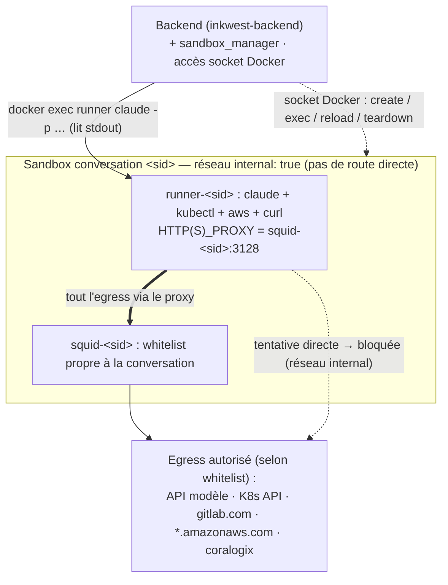
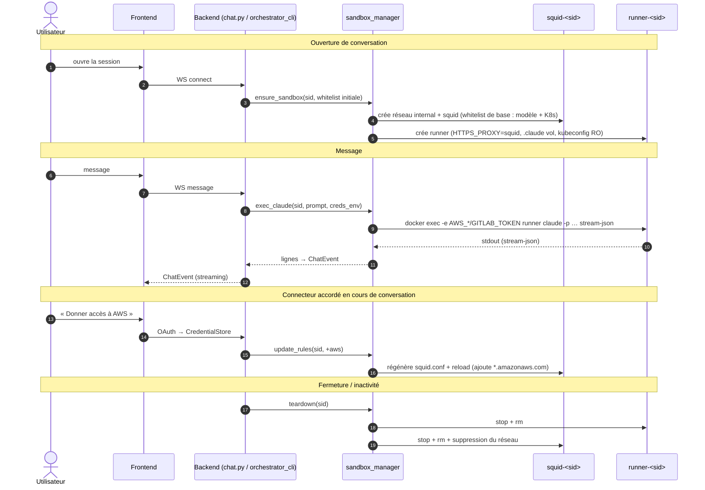
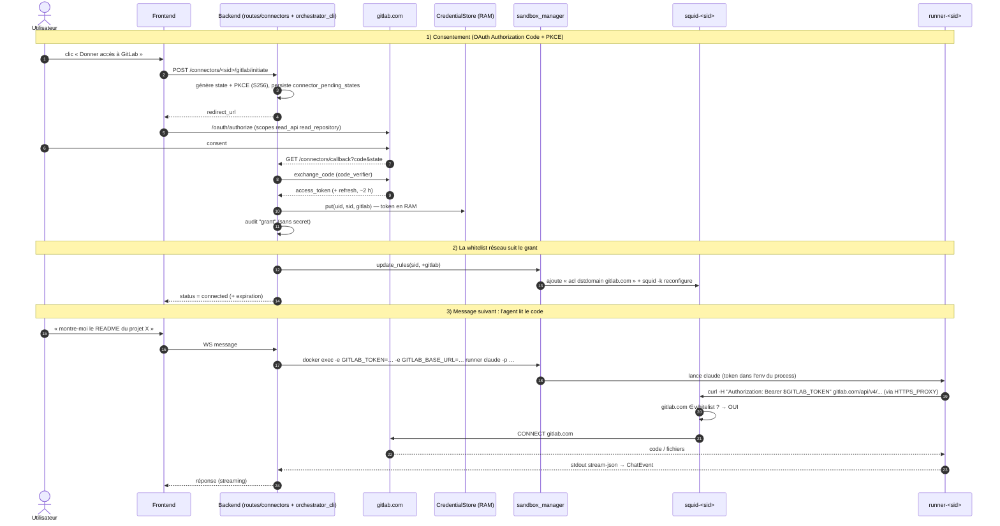
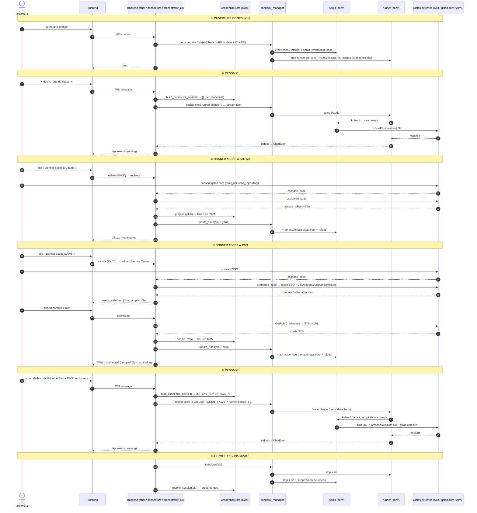

# Proposition d'architecture — Sandbox `claude` par conversation (avec Squid dédié)

> **Statut : proposition (non implémentée).** Objectif : exécuter `claude` dans une
> image Docker **isolée filesystem + réseau**, dont **tout l'egress passe par un
> Squid propre à la conversation**, avec une **whitelist par conversation** (chaque
> conversation peut avoir des règles différentes, alignées sur les connecteurs
> accordés).

## 1. Motivation

Aujourd'hui `claude` tourne dans le conteneur backend partagé → il voit `/app`,
`~/.claude`, et a un egress libre. Problèmes : pas d'isolation filesystem/réseau,
pas de contrôle des destinations.

Cible : **un bac à sable jetable par conversation**, où :
- l'agent ne voit ni la source d'Inkwest ni l'état des autres conversations ;
- **tout accès réseau sortant est forcé via un Squid**, qui n'autorise que des
  domaines explicitement whitelistés ;
- la **whitelist est propre à chaque conversation** : elle reflète les connecteurs
  réellement accordés (ex. conv. A = modèle + K8s + AWS + GitLab ; conv. B = modèle
  + K8s + Coralogix uniquement).

## 2. Principe clé sur la communication backend ↔ runner

**On ne réécrit pas le pipeline.** Le backend continue de **lancer un process et de
lire son `stdout`** (stream-json) ; on change uniquement *quel* process :

| Aujourd'hui | Proposition |
|---|---|
| `create_subprocess_exec("claude", "-p", …)` | `create_subprocess_exec("docker", "exec", "-e", …, "runner-<sid>", "claude", "-p", …)` |

→ `parse_cli_response` est **inchangé** : la « communication avec l'autre conteneur »
= le `stdout` de `docker exec`. Pas de protocole réseau custom à écrire.

On retient la variante **runner long-vécu par conversation** (`docker exec` par
message) plutôt que `docker run` éphémère : l'état `~/.claude` (auth + `--resume`)
persiste naturellement dans le runner, et il n'y a pas de coût de démarrage par
message.

## 3. Architecture cible



Seul **squid-<sid>** est bi-réseau (internal + externe). Le runner n'a **aucune
route directe** : son seul moyen de sortir est le proxy.

## 4. Cycle de vie



## 5. Contrôle d'egress + whitelist par conversation


**Whitelist dérivée des connecteurs accordés** (le levier « règles par conversation ») :

| Toujours | Si AWS accordé | Si GitLab accordé | Si Coralogix accordé |
|---|---|---|---|
| endpoint API du modèle, API server K8s | `*.amazonaws.com` (sts, sso, sso-oidc, eks, ec2, logs…) | `gitlab.com` | endpoint Coralogix |

À chaque `grant`/`revoke` de connecteur, `sandbox_manager.update_rules()` régénère le
`squid.conf` de la conversation et recharge Squid (`squid -k reconfigure`). La
whitelist réseau **suit** ainsi le moindre privilège déjà appliqué au niveau des
creds.

> HTTPS : Squid filtre sur le domaine via `CONNECT`/SNI (pas d'interception TLS, pas
> de déchiffrement) — un `acl dstdomain` suffit.

### 5.1 Exemple détaillé — « Donner accès à GitLab »

Accorder un connecteur agit sur **deux couches complémentaires** : le **token**
(couche creds) **et** la **whitelist réseau** (couche Squid). Les deux sont ajoutés au
grant et retirés au revoke → défense en profondeur.



**Étape par étape :**
1. **Consentement** : bouton → `initiate` (génère `state` + PKCE, stocke le
   pending-state) → redirection vers `gitlab.com/oauth/authorize` (scopes
   **`read_api read_repository`** uniquement) → l'utilisateur consent.
2. **Callback** : `exchange_code` échange le `code` contre un **access token** (~2 h)
   + refresh ; le token est rangé **en RAM** (`CredentialStore`, clé `(user, session,
   gitlab)`) ; ligne d'**audit** « grant » sans secret.
3. **Whitelist** : le backend appelle `sandbox_manager.update_rules(sid, +gitlab)` qui
   **ajoute `gitlab.com`** au `squid.conf` de **cette** conversation et recharge Squid.
   → l'egress vers GitLab devient possible **pour cette conversation seulement**.
4. **UI** : le badge GitLab passe à **connected** (avec expiration affichée).
5. **Usage** : au message suivant, `orchestrator_cli` injecte `GITLAB_TOKEN` +
   `GITLAB_BASE_URL` dans l'`env` du `docker exec`. L'agent fait un `curl` vers l'API
   GitLab **via le proxy Squid** ; Squid voit `gitlab.com` dans la whitelist →
   laisse passer → l'agent lit le code.

**Les deux verrous (défense en profondeur) :**

| Couche | Ajoutée au grant | Effet si manquante |
|---|---|---|
| **Token** (`GITLAB_TOKEN` injecté par session) | oui | sans token → `401` côté GitLab |
| **Whitelist Squid** (`gitlab.com`) | oui | sans whitelist → la requête n'atteint **jamais** GitLab (egress bloqué par le réseau internal) |

→ Même si un token fuyait, le runner ne pourrait pas joindre `gitlab.com` sans
l'entrée whitelist ; et inversement.

**Révocation / expiration :** au `revoke` (ou à l'expiration), le backend
(1) retire le token du store et (2) appelle `update_rules(sid, -gitlab)` qui **enlève
`gitlab.com`** de la whitelist + reload. Les deux verrous se referment ensemble.

> Note : ce schéma est l'extension « sandbox » du flux GitLab **déjà fonctionnel**
> aujourd'hui (étapes 1-2-5). Le **nouveau** est l'étape 3 (whitelist Squid dynamique)
> et le passage du token via `docker exec -e` au lieu de l'env du process backend.

### 5.2 Scénario complet de bout en bout

Ouverture de session → message → accès GitLab → accès AWS → message → fermeture.



**Lecture rapide :**
- ① la sandbox démarre avec une whitelist **minimale** (modèle + K8s) ;
- ③/④ chaque grant **étend** la whitelist Squid de la conversation (gitlab.com, puis
  `*.amazonaws.com`) **en plus** de ranger le credential en RAM ;
- ⑤ au message suivant, les creds sont injectés par `docker exec -e` et l'agent
  joint K8s + AWS + GitLab — chaque sortie passant le filtre Squid ;
- ⑥ à la fermeture, runner + squid + réseau sont détruits et les creds purgés.

## 6. Composants à créer / modifier

| Élément | Rôle |
|---|---|
| `app/services/sandbox_manager.py` *(nouveau)* | `ensure_sandbox(sid, targets)`, `exec_claude(sid, cmd, env)`, `update_rules(sid, targets)`, `teardown(sid)` — pilote réseau + squid + runner via le socket Docker |
| `app/services/ai_cli_client.py` *(modif)* | derrière `CLAUDE_CLI_SANDBOX=true`, construit `["docker","exec",…,"runner-<sid>","claude",…]` au lieu de `["claude",…]` ; `stdout` inchangé |
| `app/services/orchestrator_cli.py` *(modif)* | appelle `ensure_sandbox` à la 1re interaction, `update_rules` sur grant/revoke |
| Image `inkwest-claude-runner` *(nouveau Dockerfile)* | minimale : `claude` + `kubectl` + `aws` + `curl`, **sans** la source backend |
| `squid.conf` template *(nouveau)* | base + `acl dstdomain` générés par connecteur |
| `docker-compose` / réseaux | réseau `internal: true` par conversation ; backend monte `/var/run/docker.sock` |

Esquisse du dispatch (inchangé pour le parsing) :

```python
# ai_cli_client.execute_claude_cli (mode sandbox)
if settings.claude_cli_sandbox:
    cmd = ["docker", "exec",
           *sum((["-e", f"{k}={v}"] for k, v in extra_env.items()), []),
           f"inkwest-runner-{session_id}",
           "claude", "--dangerously-skip-permissions", "-p", prompt,
           "--output-format", "stream-json", "--verbose",
           *(["--resume", resume_session_id] if resume_session_id else [])]
else:
    cmd = ["claude", ...]   # comportement actuel
process = await asyncio.create_subprocess_exec(*cmd, stdout=PIPE, stderr=PIPE)
```

## 7. Sécurité

- **Isolation filesystem** : le runner ne monte **pas** `/app` → l'agent ne voit pas
  la source d'Inkwest.
- **Isolation réseau** : réseau `internal: true` + `HTTPS_PROXY=squid` → **aucune
  sortie hors whitelist**, par conversation.
- **Socket Docker** : seul le **backend** (de confiance) l'utilise ; le runner ne
  l'a pas → l'agent ne peut pas piloter Docker ni s'évader.
- **Secrets** : creds connecteurs passés par `-e` au `docker exec` (par message,
  depuis le store RAM) → cloisonnés par session ; jamais dans le prompt/logs.
- **Auth & historique** : `~/.claude` (auth + `--resume`) dans un volume **par
  conversation** → isolation des transcripts entre conversations.

## 8. Limites & points d'attention

1. **Coût ressources** : N conversations actives = N (squid + runner). Prévoir un
   **teardown sur inactivité** (TTL) + plafond de sandboxes concurrentes.
2. **Whitelist du CLI `claude`** : le binaire contacte plusieurs domaines (API
   Anthropic + télémétrie type statsig/sentry) ; à calibrer dans Squid sinon le CLI
   peut échouer. **Piège pratique n°1.**
3. **Latence d'ouverture** : création réseau + squid + runner au démarrage de
   conversation (quelques secondes, une seule fois).
4. **DooD** : acceptable en dev ; en **prod**, préférer l'équivalent Kubernetes
   (cf. §9).
5. **Nettoyage** : noms déterministes (`inkwest-runner-<sid>`, `inkwest-squid-<sid>`,
   réseau `inkwest-conv-<sid>`) + reaper en cas de crash backend.

## 9. Équivalent production (Kubernetes)

- 1 **Pod par conversation** (ou par message) avec le conteneur runner ;
- **NetworkPolicy** « default-deny egress » + egress autorisé uniquement vers un
  **proxy Squid** (sidecar ou service) dont la conf est générée par conversation
  (ConfigMap) ;
- pas de socket Docker — l'API K8s (ServiceAccount restreint) crée/détruit les Pods.

## 10. Plan de mise en œuvre (par phases)

1. **Image runner** (`inkwest-claude-runner`) + auth `claude` validée dedans.
2. **`sandbox_manager`** : create/exec/teardown (whitelist statique de base d'abord).
3. **Flag `CLAUDE_CLI_SANDBOX`** + bascule dans `ai_cli_client` (stdout inchangé).
4. **Squid dynamique** : génération `squid.conf` par connecteur + `reload` sur
   grant/revoke.
5. **Lifecycle** : teardown idle/fermeture + reaper + plafond.
6. **Durcissement** : logs d'egress Squid (audit réseau), tests d'isolation
   (vérifier qu'une destination hors whitelist est bien refusée).

---

### Récapitulatif de la décision de comms
La brique qui « parle à l'autre conteneur » reste un **spawn de process + lecture
stdout** (`docker exec … claude -p … stream-json`). Aucun protocole réseau custom :
le changement est concentré dans `ai_cli_client` (construction de la commande) et un
nouveau `sandbox_manager` (cycle de vie réseau/squid/runner).
```
